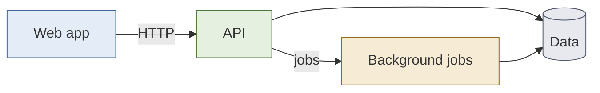
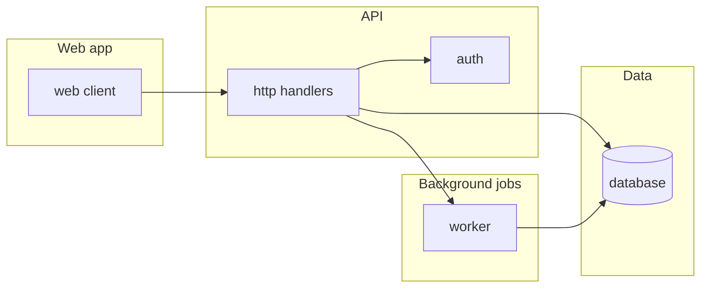

# Architecture Map

> Generated by the `architecture-map` skill. This is a structural orientation aid, not a source of truth for business logic or specific behaviour — verify anything load-bearing against the actual code.
>
> Domains with substantial detail are split into `.architecture/domains/<domain>.md` — follow the link in the table below rather than expecting everything inline here.

## Domain map

<Replace with one node per domain (roughly 4-10). Node ids are the domain ids from the Domains table and the colour classes are the domains' colours. This diagram is canonical: floor walks copy it verbatim, so keep ids, order and colours stable across refreshes (see the skill's "Canonical maps" rules).>

## Structure overview

<Replace with the actual components, one subgraph per domain whose id is the domain id. Keep nodes at component/service granularity, not individual files or classes (roughly 10-20 nodes). Node ids are short snake_case and stable: floor walks reuse them to draw the detail map.>

## Domains

| Domain | Id | Colour | Path | Description | Details |
|---|---|---|---|---|---|
| <plain name> | `<domain_id>` | <colour from the palette> | `<path>` | <one-line description> | <link to `.architecture/domains/<slug>.md`, or "—" if not split out> |

## Apps / packages

| Name | Path | Description |
|---|---|---|
| `<name>` | `<path>` | <what it is> |

## Frontend / backend boundaries

<Where the split is, if any, and how the sides communicate. Prose is fine here — this rarely has enough discrete items to need a table.>

## Test organisation

<Where tests live, naming conventions, test levels in use, repo-wide. Domain-specific test conventions that differ from this belong in that domain's sub-map instead.>

## Build / package configuration

<Build tooling, package manifests, key config files.>

## Developer & architecture docs

| Doc | Path |
|---|---|
| `<name>` | `<path>` |

## Notable conventions

<Anything else useful for orientation: monorepo tooling, codegen, linting, etc.>
